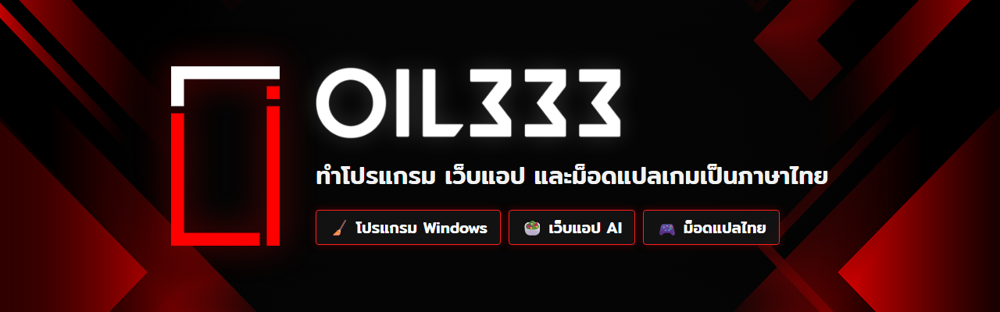

  

  ชอบสร้างของที่ใช้ได้จริงในชีวิตประจำวัน ตั้งแต่โปรแกรมบน Windows เว็บแอปที่ใช้ AI 
  ไปจนถึงม็อดที่ทำให้เล่นเกมเป็นภาษาไทยได้

 

## 🛠️ ผลงาน

<table>
  <tr>
    <td width="96" align="center"></td>
    <td>
      <b><a href="https://oil333.github.io/thai-mods/">TripleT Translate</a></b> · ม็อดแปลเกมเป็นภาษาไทย 
      ติดตั้งไม่กี่ขั้นตอน โลโก้เกมก็เป็นภาษาไทย ตอนนี้มี 3 เกม: <b>Train45</b>, <b>Yohane the Parhelion</b> และ <b>Love Live! Nijigasaki TOKIMEKI Roadmap to the Future</b> 
      Godot (GDScript) · Unity + BepInEx (C#) · Python · แปลด้วย AI 
      <a href="https://oil333.github.io/thai-mods/">🌐 เว็บไซต์ + ดาวน์โหลด</a> &nbsp;·&nbsp; <a href="https://github.com/OIL333/thai-mods">📦 repo</a>
    </td>
  </tr>
  <tr>
    <td width="96" align="center"></td>
    <td>
      <b><a href="https://eat-mindfully.web.app">Eat Mindfully</a></b> · เว็บแอปวางแผนอาหารและออกกำลังกายด้วย AI 
      กรอกข้อมูลสุขภาพแล้วได้แผนอาหาร 3 มื้อ + ตารางออกกำลังกาย 7 วันตามเป้าหมายพลังงาน คำนวณโภชนาการจากฐานข้อมูลอาหารไทย และแนะนำร้านที่มีเมนูตรงแผน 
      React · Vite · Firebase · Gemini 
      <a href="https://eat-mindfully.web.app">🌐 ลองใช้งาน</a>
    </td>
  </tr>
  <tr>
    <td width="96" align="center"></td>
    <td>
      <b>LIAM Cleaner</b> · โปรแกรมล้างไฟล์ขยะบน Windows แบบปลอดภัย 
      สแกนไฟล์ขยะ 7 หมวด ย้ายลงถังขยะเป็นค่าเริ่มต้นจึงกู้คืนได้เสมอ ข้ามไฟล์ที่กำลังใช้งาน และปักหมุดไฟล์ที่ไม่อยากให้แตะได้ 
      Tauri 2 · Rust · React
    </td>
  </tr>
</table>

 

## 🧰 เครื่องมือที่ใช้บ่อย

  
  
  
  
  
  
  
  
  
  

 

## 🎮 ม็อดแปลไทยที่แจกอยู่

<table>
  <tr>
    <td width="33%" valign="top">
       
      <b>🚃 Train45</b> 18+ 
      ✅ พร้อมเล่น · v1.0.2 
      <a href="https://oil333.github.io/thai-mods/adult.html#train45">ดาวน์โหลด + วิธีติดตั้ง →</a>
    </td>
    <td width="33%" valign="top">
       
      <b>🌊 Yohane the Parhelion</b> 
      🧪 เวอร์ชันทดลอง · v1.0.3-beta 
      <a href="https://oil333.github.io/thai-mods/#yohanuma">ดาวน์โหลด + วิธีติดตั้ง →</a>
    </td>
    <td width="33%" valign="top">
       
      <b>🌈 Nijigasaki TOKIMEKI Roadmap</b> ใหม่ 
      🧪 เวอร์ชันทดลอง · v1.0.1-beta 
      <a href="https://oil333.github.io/thai-mods/#nijichizu">ดาวน์โหลด + วิธีติดตั้ง →</a>
    </td>
  </tr>
</table>

อยากให้แปลเกมไหน บอกได้ที่ [หน้าเสนอแนะ](https://oil333.github.io/thai-mods/report.html?type=idea) ครับ 💡

 

  <a href="https://oil333.github.io/thai-mods/report.html"><b>📮 ติดต่อ / แจ้งปัญหา</b></a> &nbsp;·&nbsp;
  <a href="https://oil333.github.io/thai-mods/donate.html"><b>🍵 เลี้ยงชาเขียว</b></a> &nbsp;·&nbsp;
  <a href="https://www.facebook.com/TripleT.Translate/"><b>📘 เพจ Facebook</b></a>

